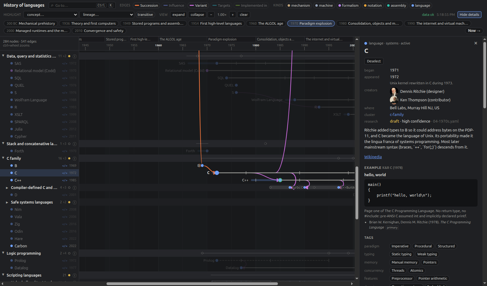

# History of programming languages

A researched, cited dataset of programming-language ancestry, from the Antikythera mechanism and
Jacquard's loom through machine code and assemblers to Zig, Carbon and the esoterics that make a point,
plus an interactive timeline to explore it: who descends from whom, which dialects and successors
branched off where, and when each idea (garbage collection, lambdas, async/await) reached which language.

**[Open the timeline →](https://sunsided.github.io/history-of-languages/)**



The data is the product: every node, strong edge and code example points at a source, every record says
how thoroughly it has been checked, and what is not verified yet is marked as such (see
[Status Quo](#status-quo)).

## Repository layout

Everything is YAML authored by hand (or by research agents) and compiled into one `dist/graph.json`.

```
schema/dataset.schema.json   JSON Schema for every record type
data/nodes/*.yaml            languages, assemblers, machines, notations, formalisms (grouped by period)
data/clusters.yaml           collapsible subgraphs + their research backlogs
data/concepts.yaml           tag registry (paradigms, typing, memory, concurrency, features, domains)
data/eras.yaml               coarse periods
data/lineages/*.yaml         narrative threads through the graph (concurrency, OOP, ...)
data/claims.yaml             myth-vs-fact checks with quoted evidence
data/sources.yaml            bibliography; every claim points here
tools/build.py               validate + derive inverse edges + emit dist/graph.json
tools/report.py              research to-do: thin clusters, orphans, weak edges, concept dating
docs/authoring.md            the format contract, with templates (read before adding data)
viewer/                      the interactive timeline (SvelteKit), see Viewer below
.github/workflows/           GitHub Pages deployment, actionlint and zizmor
CLAUDE.md, .claude/skills/   working rules and research procedures for Claude sessions
```

Run `python3 tools/build.py` (needs `pyyaml`, `jsonschema`). It fails on any schema error or dangling
reference and warns when an influence edge points forward in time. `--missing` lists undefined ids.

## Model

**Nodes** have a `kind`: `mechanism` (fixed-function device), `machine` (its instruction set *is* its
machine code), `formalism`, `notation` (written but not executed, such as Note G), `assembly`, `language`.
`category` is audience (systems, scientific, esoteric, ...), not paradigm.

**Edges** are stored once, on the newer node, pointing back in time. `build.py` derives the inverses.

| stored on newer node | derived on older node | meaning |
|---|---|---|
| `influenced_by` | `influenced` | design influence; `aspects` lists which concepts travelled |
| `successor_of` | `superseded_by` | intended replacement in the same line |
| `dialect_of` / `superset_of` / `subset_of` / `fork_of` | `has_dialect` / ... | same language, different variant |
| `targets` | `targeted_by` | assembly → machine; program → machine |
| `implemented_in` | `used_to_implement` | bootstrapping history |

Each edge carries `weight` (strong / moderate / weak), `confidence` (high / medium / low), an optional
`year` when the influence came with a later version (JavaScript got async/await from C# in 2017, not 1995),
a `note`, and `sources`.

**Tags, not labels.** Paradigms are concept ids under `tags.paradigm`, next to `typing`, `memory`,
`concurrency`, `features` and `domain`. Tags describe the language as of today; **`milestones[].introduces`
says when each concept arrived**. That is how convergence becomes visible: Java gains `lambdas` in 8 and
`virtual-threads` in 21, C# gains `async-await` in 5.0, Fortran gains `object-oriented` in 2003. A
"functional" filter on the site can then be a time slider, not a fixed bucket.

**Concepts** have a `broader` hierarchy (`goroutines` → `green-threads` → `threads`) and a `first_seen`
pointer to the earliest node in the dataset credited with them.

**Lineages** are ordered steps through the graph. Each step names nodes, concepts, non-language
`systems` (CTSS, Windows 3.x, epoll) and sources, so the site can highlight a path and play it as a story.

**Claims** are fact-checks with verdicts and quoted, located evidence.

## Photos and portraits

`data/media-subjects.yaml` lists what we want a picture of: every machine node and every named creator,
each pointing at an English Wikipedia article (or a specific Commons file). `tools/fetch_media.py` asks the
Wikipedia and Commons APIs for the lead image, keeps only files hosted on Wikimedia Commons under a free
license (public domain, CC0, CC BY, CC BY-SA, GFDL), writes `data/media.yaml` with credit, license,
caption and source, and downloads 800px copies into `assets/media/`. Non-free images (common for living
people) are skipped and listed. The site must display each image's `credit` and `license`.

```
python3 tools/fetch_media.py --dry-run   # see what would be used
python3 tools/fetch_media.py             # write data/media.yaml + assets/media/
```

## Unfolding subgraphs (the research workflow)

Clusters are both the UI's collapsible groups and the unit of research. A cluster id is a path
(`algol/wirth` is inside `algol`). Each has a `research_status`, a `backlog` of nodes still to add, and
`research_questions`. To unfold one:

1. Pick a cluster whose status is `stub` or `draft`.
2. Find the primary sources first (HOPL papers, language reports, designers' own histories), add them to
   `sources.yaml`.
3. Add backlog items as nodes (start at `research_status: stub` if only dated), fill edges with
   `aspects`, `confidence` and `sources`.
4. Re-read cited sources; set `checked: <date>` on sources actually verified and raise nodes to `reviewed`.
5. Run `build.py`, then raise the cluster's status.

`research_status` on nodes: `stub` = name and date; `draft` = filled from secondary sources and memory of
primary ones; `reviewed` = checked against primary sources.

## Status Quo

As of 2026-11-01:

- 284 nodes, 541 edges, 248 concepts, 76 clusters, 444 sources (290 marked `checked`), 163 photos,
  2 lineages, 6 claims.
- Only C++ is `reviewed`: Stroustrup's HOPL-II paper was re-read and quoted
  (`sources.yaml` → `stroustrup-1993-hopl2`). Of the rest, 246 nodes are `draft` and 37 `stub`: dates and
  edges come from well-established histories and are cited, but not yet re-read line by line.
- Every node has a code example; 24 of them are marked as illustrative or reconstructed because nothing
  executable survives.
- 130 of 248 concepts still need a summary.
- 14 edges are `confidence: low`: hypotheses to confirm or delete.

## Viewer

`viewer/` is a SvelteKit app (yarn via corepack) that renders the data as an expandable timeline:
clusters fold and unfold, clicking a language highlights its ancestry and descendants, a concept or
lineage can be traced through time, and Ctrl/⌘-K opens a command palette for jumping to any language,
cluster, concept, lineage or era.

In development it reads `data/**/*.yaml` directly through a Vite plugin and pushes updates to the browser
on every save, so there's no need to run `build.py` first. That loader is lenient: it reports broken YAML
and dangling references in the toolbar, but the schema is only checked by `build.py`.

```
task dev              # http://localhost:5173, hot reload for code and data
task check            # svelte-check
task data:build       # validate + emit dist/graph.json
task build            # static site in viewer/build (BASE_PATH=/sub/path for a sub-path deployment)
task preview          # serve that build
task lint:workflows   # actionlint + zizmor over .github/
```

The static build bundles the dataset and search index into the app and copies the photos it references.
`.github/workflows/pages.yml` validates the data, type-checks the viewer and deploys that build to GitHub
Pages on every push to `main` that touches the data, photos or viewer.
